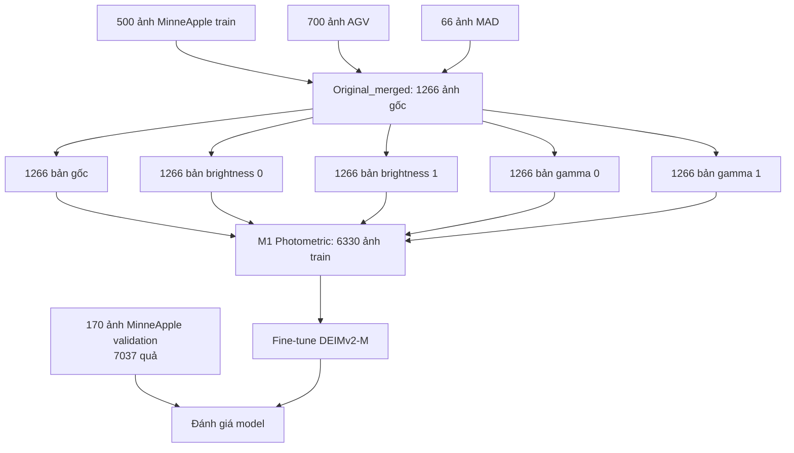

# Dòng DEIMv2-M — M1 Photometric được tạo ra như thế nào?

Đối chiếu ngày 14/11/2026 với báo cáo 12/11/2026, records dữ liệu, log train và prediction cache gốc ở `D:/Model CV`.

## Kết quả đang nói tới

| Model / tập train | mAP50 | F1 | MAE | RMSE |
|---|---:|---:|---:|---:|
| DEIMv2-M — M1 Photometric | 0.879123 | 0.824363 | 3.352941 | 4.724156 |

Đây là một lượt fine-tune detector pretrained trên M1, sau đó đánh giá full-image trên MinneApple validation. Không phải train từ đầu, không phải kết quả trên tập train, không phải mode tiled_full và chưa phải đánh giá test độc lập.

## 1. Dữ liệu train đến từ đâu?



Đã đếm trực tiếp records:

| Bộ | Ảnh | Ảnh gốc duy nhất | Số box/nhãn |
|---|---:|---:|---:|
| Original | 500 | 500 | 21,136 |
| Original_merged | 1,266 | 1,266 | 46,476 |
| M1 | 6,330 | 1,266 | 232,380 |
| Validation | 170 | 170 | 7,037 |

Mỗi ảnh cha trong M1 có đúng 5 bản: file gốc và các hậu tố `_aug1_a_bright_0`, `_aug1_a_bright_1`, `_aug1_b_gamma_0`, `_aug1_b_gamma_1`. Vì vậy **6.330 là số ảnh sau augmentation, không phải 6.330 cảnh chụp độc lập**. Nhãn xuất hiện lại theo các biến thể ảnh; không phải 232.380 quả vật lý khác nhau.

Nguồn dataset mà experiment khai báo là `nhtnguye/merged-apple-dataset` v1, `nhtnguye/aug-dataset` v1 và input `nhtnguye/dataminesapple`; pipeline lấy nhãn TXT từ bộ merged/aug tương ứng. M1 được đọc từ folder augmentation offline `1_brightness`, không phải code train tự tạo toàn bộ 6.330 ảnh.

Records xác nhận tên và số lượng các bản bright/gamma; không dùng tên file để suy ra tham số alpha/gamma cụ thể nếu thiếu source sinh augmentation. Không mặc định M1 tương đương ký hiệu S01 của một bộ tài liệu khác.

Đối chiếu thêm `H:/FruitCount_Kaggle_Infrastructure` cho thấy một protocol đếm dữ liệu khác: manifest audit YOLO giữ `Original_merged = 1.266` và `M1_Photometric = 5.064` riêng. Code `kaggle_baseline/merge_audit_cache.py` loại ảnh trùng theo SHA256 và giữ ảnh gốc ở nhóm merged, nên M1 tại đó chỉ còn 4 biến thể/ảnh cha. Con số này không thay đổi tập M1 6.330 ảnh thực tế của lượt DEIMv2 trong `D:/Model CV`. Khi so sánh experiment cần ghi rõ giữ hay bỏ ảnh gốc trong nhóm augmentation.

Chưa tìm thấy bảng quy đổi chính thức S01–S10 sang M1/M2/M3/M5 trong phạm vi tài liệu đã tra cứu ở hai thư mục. Vì vậy câu trả lời chắc chắn là M1 thuộc bộ gộp được tăng cường quang học; riêng tên S01 cần định nghĩa của checklist trước khi gán.

## 2. Train và validation được chia như thế nào?

Train của dòng này là M1, 6.330 ảnh; validation cố định là 170 ảnh MinneApple, 7.037 quả. Không chia ngẫu nhiên lại 80/20 từ M1 và không đưa các biến thể của validation vào train.

Đối chiếu theo tên ảnh cha sau bỏ hậu tố `_aug`: số ảnh cha giao nhau giữa M1 và validation bằng 0. Đây là kiểm tra identity theo records; không thay thế phép kiểm tra trùng ảnh bằng nội dung/pixel. Pipeline audit còn kiểm tra ảnh, box, nhãn, EXIF orientation và source-parent overlap. Cây `test/` ngoài không được dùng để train trong experiment này.

Nhãn là detection một lớp apple/fruit: mỗi quả có một bounding box. Việc đếm ground truth là đếm số box, không phải phân loại toàn ảnh thành một số lượng.

## 3. Đã làm gì với DEIMv2-M?

1. Dùng native DEIMv2-M khoảng 18.2 triệu tham số, backbone ViT-TinyPlus được distill từ DINOv3, adapter không gian và decoder detection.
2. Khởi tạo bằng detector pretrained COCO, không phải random toàn bộ. Lớp apple trong COCO dùng để khởi tạo head một lớp; source kiểm tra độ phủ pretrained và backbone.
3. Đọc ảnh theo EXIF, đổi RGB, resize vuông 832×832, chuẩn hóa ImageNet.
4. Ngoài M1 offline, lúc train còn horizontal flip xác suất 0.5 và jitter nhẹ brightness/contrast/color trong khoảng 0.9–1.1. Validation không áp dụng các augmentation ngẫu nhiên này.
5. Train bằng 2 Tesla T4, DDP, seed 42, 20 epoch. Batch vật lý 2 ảnh/GPU, tích lũy 4 bước: batch hiệu dụng thông thường 16 ảnh.
6. Hai epoch đầu đóng băng backbone; 18 epoch còn lại fine-tune toàn model. AdamW, LR head 1e-4, backbone 1e-5, weight decay 1e-4; dùng AMP, EMA, warmup/cosine và gradient clipping.
7. Mỗi epoch đánh giá EMA trên validation, tìm confidence có MAE tốt nhất trên grid 0.15–0.70, bước 0.025; giữ checkpoint tốt nhất theo tiêu chí này.

## 4. Vì sao dùng checkpoint epoch 8?

`training_log.csv` có đủ 20 epoch. Dòng epoch 8 ghi:

```text
epoch = 8
val_mae = 3.3529411764705883
val_rmse = 4.724155697987052
count_threshold = 0.4
world_size = 2
```

Đây là checkpoint được chọn. `best.pt` lưu EMA state tại khóa `model`; không đồng nhất với model ở epoch 20 trong `last.pt`. Train đủ 20 epoch không có nghĩa bảng cuối lấy epoch 20.

## 5. Tính ra bốn con số trong hình như thế nào?

Suy luận toàn ảnh ở 832×832. Đổi box về tọa độ ảnh gốc, lọc confidence thấp và NMS IoU 0.6. Không ghép tile/WBF trong dòng full-image này.

- **mAP50 = 0.879123:** chất lượng detection tại IoU 0.50, dùng evaluator AP của notebook tham chiếu. Không phải tỷ lệ phần trăm quả đếm đúng.
- **F1 = 0.824363:** ghép box dự đoán với GT ở IoU 0.50, confidence detection 0.35; cân bằng precision và recall.
- **MAE = 3.352941:** mỗi ảnh đếm box có score >= 0.40; lấy trung bình sai số tuyệt đối so với số box GT.
- **RMSE = 4.724156:** căn bậc hai trung bình bình phương sai số đếm, nhạy hơn với các ảnh sai lớn.

Đã đọc lại 170 file NPZ trong `evaluation/full` và tính lại số đếm:

```text
Tổng sai số tuyệt đối = 570 quả
MAE = 570 / 170 = 3.3529411764705883
Tổng bình phương sai số = 3794
RMSE = sqrt(3794 / 170) = 4.724155697987052
```

Hai kết quả khớp báo cáo và epoch 8. mAP/F1 ở đây trích từ metrics gốc; lần đối chiếu này không tuyên bố chạy lại model trên toàn bộ 170 ảnh hoặc tính lại AP. Báo cáo audit trước đó đã replay evaluator trên prediction cache.

## 6. Có thể kết luận gì?

Có thể nói: **với pipeline, seed và validation này, DEIMv2-M fine-tune trên M1 có sai số đếm trung bình thấp nhất trong bảng full-image đã chạy**.

Chưa thể nói M1 luôn tốt hơn Original: baseline DEIMv2/Original có MAE 3.370588, chỉ chênh khoảng 0.017647 quả/ảnh; chưa có nhiều seed hoặc test độc lập để đánh giá độ ổn định. Validation đã tham gia chọn checkpoint và ngưỡng, nên kết quả này là validation, không phải test 114 ảnh được nhắc trong checklist khác.

## Nguồn local

- `D:/Model CV/reports/FRUITCOUNT_RESULTS_REPORT_2026-11-12.md`
- `D:/Model CV/experiments/fruitcount_deimv2/README.md`
- `D:/Model CV/experiments/fruitcount_deimv2/data_pipeline.py`
- `D:/Model CV/experiments/fruitcount_deimv2/train_worker.py`
- `D:/Model CV/experiments/fruitcount_deimv2/outputs/m1_part2/fruitcount_deimv2/records/{Original,Original_merged,M1,val}.json`
- `D:/Model CV/experiments/fruitcount_deimv2/outputs/m1_part2/fruitcount_deimv2/runs/M1/{config.json,training_log.csv,training_complete.json,metrics.json,evaluation/full/*.npz}`
- `analysis_outputs/model_integration/m1_data_provenance.json` lưu các con số đã kiểm tra ở lần này.
