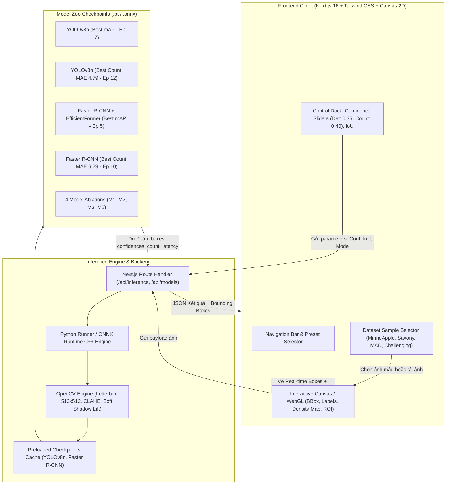
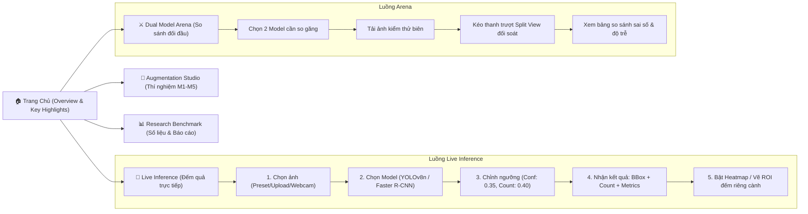

# ĐẶC TẢ YÊU CẦU PHẦN MỀM & THIẾT KẾ GIAO DIỆN WEBSITE DEMO
# BÀI TẬP LỚN COMPUTER VISION: PHÁT HIỆN & ĐẾM QUẢ TÁO TỰ ĐỘNG (FRUIT COUNTING)

> **Dự án**: Computer Vision & Precision Agriculture — Apple Detection & Yield Estimation in Orchard Environments  
> **Kiến trúc mô hình cốt lõi**: 
> - **Faster R-CNN** tích hợp backbone lai Vision Transformer **EfficientFormerV2-S0 + FPN** (Two-stage)  
> - **YOLOv8n** (One-stage Anchor-free Decoupled Head)  
> **Dữ liệu huấn luyện**: Hợp nhất đa miền (MinneApple, Saxony AGV 874 ảnh vàng, MAD) + 4 hướng Augmentation vật lý (M1, M2, M3, M5) $\to$ Siêu tập Step 3 với **21.518 ảnh**.  
> **Tài liệu tham chiếu**: [`BAO_CAO_XU_LY_DATA_VA_THUC_NGHIEM_FRUITCOUNT.md`](file:///d:/CV/BTL/Data/detection/BAO_CAO_XU_LY_DATA_VA_THUC_NGHIEM_FRUITCOUNT.md)

---

## MỤC LỤC
1. [Mục Tiêu & Định Vị Của Website Demo](#1-mục-tiêu--định-vị-của-website-demo)
2. [Kiến Trúc Công Nghệ & Luồng Xử Lý (System Architecture)](#2-kiến-trúc-công-nghệ--luồng-xử-lý-system-architecture)
3. [Danh Sách Các Chức Năng Cốt Lõi (Core Features)](#3-danh-sách-các-chức-năng-cốt-lõi-core-features)
   - Chức năng 1: Live Inference & Yield Estimator (Phát hiện & Đếm quả thời gian thực)
   - Chức năng 2: Dual Model Arena (Đấu trường so sánh trực tiếp 2 mô hình)
   - Chức năng 3: Augmentation Studio & Stress Test (Trực quan hóa 4 hướng tăng cường M1, M2, M3, M5)
   - Chức năng 4: Research Benchmark & Data Explorer (Bảng vàng số liệu & Báo cáo khoa học)
   - Chức năng 5: Video & Orchard Track Simulator (Ước tính sản lượng theo hàng cây)
4. [Sơ Đồ Luồng Người Dùng & Điều Hướng (User Flow & Site Navigation)](#4-sơ-đồ-luồng-người-dùng--điều-hướng-user-flow--site-navigation)
5. [Sơ Đồ Giao Diện Chi Tiết (UI Wireframe & Layout Blueprints)](#5-sơ-đồ-giao-diện-chi-tiết-ui-wireframe--layout-blueprints)
   - 5.1. Layout Tổng quan & Navigation Header
   - 5.2. Màn hình 1: Live Inference & Counting Studio
   - 5.3. Màn hình 2: Dual Model Arena (Side-by-Side Split View)
   - 5.4. Màn hình 3: Augmentation Interactive Studio
   - 5.5. Màn hình 4: Benchmark & Analytics Dashboard
6. [Lộ Trình Triển Khai Kỹ Thuật (Implementation Roadmap)](#6-lộ-trình-triển-khai-kỹ-thuật-implementation-roadmap)

---

## 1. MỤC TIÊU & ĐỊNH VỊ CỦA WEBSITE DEMO

### 1.1. Mục tiêu đồ án
Website demo không chỉ đơn thuần là công cụ "tải ảnh lên và vẽ khung chữ nhật", mà là một **sản phẩm hoàn chỉnh phục vụ báo cáo bảo vệ Bài tập lớn / Nghiệm thu khoa học**, làm nổi bật các đóng góp then chốt:
1. **Chứng minh tính thực tiễn trong Nông nghiệp chính xác (Precision Agriculture)**: Khả năng ước lượng số lượng quả thực tế trên từng cây/hàng cây với độ chính xác cao ($R^2 \ge 0.96$, sai số $\text{MAE} \approx 3.7 \sim 5.0$ quả).
2. **Đối đầu công nghệ giữa 2 trường phái kiến trúc**: 
   - Two-stage Hybrid ViT (**Faster R-CNN + EfficientFormerV2-S0**) chuyên sâu về ngữ cảnh không gian phức tạp.
   - One-stage Anchor-free CNN (**YOLOv8n**) siêu tốc độ (~10.5 ms / 95 FPS), độ chính xác cao.
3. **Thuyết minh trực quan sức mạnh của 4 thuật toán Data Augmentation**: Cho phép hội đồng tận mắt thấy việc xử lý quang học (M1), phổ màu mặt trời (M2), che khuất tán lá (M3), và nâng sáng bóng râm mềm (M5) đã cứu sống các trường hợp quả bị che khuất và chìm sâu trong hốc tán cây như thế nào.
4. **Trực quan hóa sự đánh đổi khoa học (Scientific Trade-off)**: Checkpoint Best (tối ưu định vị mAP phục vụ robot hái tự động) vs Checkpoint Last (tối ưu sai số đếm MAE phục vụ dự báo sản lượng).

### 1.2. Người dùng mục tiêu
- **Giảng viên hướng dẫn & Hội đồng bảo vệ BTL**: Cần xem nhanh hiệu năng, bấm thử các trường hợp biên khó (ảnh chói sáng, quả khuất, ảnh mật độ 300 quả của MAD).
- **Sinh viên / Thành viên nhóm**: Sử dụng để thuyết trình trực tiếp trên máy chiếu.
- **Khách tham quan / Người dùng phổ thông**: Trải nghiệm cảm giác kiểm kê trang trại thông minh.

---

## 2. KIẾN TRÚC CÔNG NGHỆ & LUỒNG XỬ LÝ (SYSTEM ARCHITECTURE)



### Điểm nhấn kỹ thuật:
- **Tối ưu tốc độ hiển thị**: Ảnh đầu vào được xử lý theo chuẩn **Letterbox 512×512** (giữ nguyên tỉ lệ hình tròn của quả táo).
- **Hỗ trợ chạy Offline / Zero-lag**: Tích hợp sẵn trọng số ONNX để có thể suy luận trực tiếp bằng **ONNX Runtime Web (Wasm/WebGPU)** ngay trên trình duyệt mà không cần cài đặt Python trên máy người xem nếu cần.
- **Preloaded Models**: Các checkpoint trọng số được load sẵn vào bộ nhớ RAM/GPU khi khởi động server, không bắt người dùng phải upload file model nặng 50MB–200MB.

---

## 3. DANH SÁCH CÁC CHỨC NĂNG CỐT LÕI (CORE FEATURES)

### 🍎 Chức năng 1: Live Inference & Yield Estimator (Phát hiện & Đếm quả thời gian thực)
Là trung tâm trải nghiệm của website:
1. **Lựa chọn Mô hình suy luận (Model Selector)**:
   - Danh sách model tích hợp sẵn:
     - `YOLOv8n (Best mAP @ Ep 7)` — Khuyên dùng cho định vị vật thể & tốc độ.
     - `YOLOv8n (Best Count MAE @ Ep 12)` — Khuyên dùng cho đếm sản lượng chuẩn xác (MAE 4.79).
     - `Faster R-CNN + EfficientFormerV2-S0 (Best mAP @ Ep 5)`.
     - `Faster R-CNN (Best Count @ Ep 10)`.
     - `Ablation Models`: M1 (Photometric), M2 (Color Temp), M3 (Occlusion ViT Top 1), M5 (Shadow Lift Top 1).
   - Tùy chọn tải lên file trọng số tùy chỉnh (`.pt`, `.onnx`).
2. **Nguồn dữ liệu đầu vào linh hoạt (Input Sources)**:
   - **Thư viện mẫu chuẩn (Standard Benchmark Gallery)**: Gồm hơn 20 ảnh tiêu biểu đại diện cho:
     - *MinneApple*: Chùm quả đan xen, táo đỏ/táo xanh lẫn lá.
     - *Saxony AGV*: Robot tự hành chụp toàn cảnh cây táo, cự ly cố định (kèm Ground Truth thực tế được đếm tay).
     - *MAD Drone & Ground*: Mật độ cực cao ($100 \sim 400$ quả/ảnh), góc nghiêng từ trên không.
     - *Thử thách thời tiết*: Ngược sáng chói gắt, bóng râm tối mịt, cành lá rậm rạp.
   - **Tải ảnh cá nhân (Upload / Drag & Drop)**: Hỗ trợ JPG, PNG, WEBP lên đến 20MB.
   - **Chụp từ Camera / Webcam trực tiếp**: Dành cho trường hợp mang máy tính/điện thoại ra trước quả táo thật hoặc ảnh mẫu để test.
3. **Bộ điều khiển ngưỡng thông minh (Dual Confidence Dock)**:
   - **Detection Confidence Threshold (mặc định 0.35)**: Dùng để lọc bounding box hiển thị trên màn hình.
   - **Counting Confidence Threshold (mặc định 0.40)**: Ngưỡng tối ưu đếm quả độc lập đã được chứng minh trong báo cáo thực nghiệm giúp triệt tiêu False Positives ở kẽ lá.
   - **IoU NMS Threshold (mặc định 0.50)**: Khử trùng lặp box.
   - **Nút "Auto-Optimize"**: Tự động chuyển đổi thông số giữa 2 kịch bản: `Robotic Harvesting (Ưu tiên Precision)` vs `Yield Estimation (Ưu tiên MAE)`.
4. **Bộ trực quan hóa Canvas đa chế độ (Interactive Canvas Overlay)**:
   - Bật/tắt Bounding Box, Tỉ lệ tin cậy (Confidence Tag), Số thứ tự quả (#1, #2, ...).
   - **Chế độ Heatmap mật độ (Density Heatmap)**: Trực quan hóa vùng chùm quả tập trung dày đặc nhất trên cây.
   - **Khoanh vùng đếm (ROI Tool)**: Cho phép người dùng vẽ một khung chữ nhật hoặc đa giác chỉ định một nhánh cây cụ thể để xem số lượng quả riêng của nhánh đó.
   - Zoom/Pan mượt mà trên ảnh độ phân giải cao ($4\text{K}$).
5. **Thước đo kết quả chi tiết (Real-time Telemetry Card)**:
   - **Tổng số quả đếm được (Estimated Fruit Count)**.
   - **Số quả thực tế (Ground Truth Count)** (khi chạy trên ảnh mẫu benchmark).
   - **Sai số đếm tuyệt đối**: $\Delta = |\text{Pred} - \text{GT}|$ và tỷ lệ phần trăm sai số.
   - **Tốc độ suy luận**: Độ trễ (ms) và số khung hình/giây (FPS).
   - **Phân phối kích thước quả**: Tỉ lệ quả nhỏ ($< 32^2$), quả vừa ($32^2 \sim 96^2$), quả lớn ($> 96^2$).

---

### ⚔️ Chức năng 2: Dual Model Arena (Đấu trường so sánh trực tiếp 2 mô hình)
Chức năng gây ấn tượng mạnh nhất khi bảo vệ đồ án:
1. **So sánh song song (Side-by-Side Synchronized View)**:
   - Cho phép chọn **Model A** (ví dụ: Faster R-CNN ViT) và **Model B** (ví dụ: YOLOv8n) hoặc so sánh **Baseline vs Augmented Model**.
   - Chạy inference đồng thời trên cùng một bức ảnh.
2. **Thanh trượt so sánh (Interactive Split Slider)**:
   - Kéo qua trái/phải để so sánh từng chi tiết nhỏ (ví dụ: quả nằm sau lá cây thì Faster R-CNN có nhận ra không, YOLOv8n có bị nhận nhầm đốm lá thành quả không).
3. **Bảng đối đầu trực tiếp (Head-to-Head Scoreboard)**:
   - So sánh trực quan: Số quả đếm được, Sai số so với nhãn gốc, mAP tham chiếu, Độ trễ (Latency).
   - Chỉ ra cụ thể các box khác biệt (Mismatch Inspector): Box nào Model A phát hiện mà Model B bỏ sót.

---

### 🔬 Chức năng 3: Augmentation Studio & Stress Test (Trực quan hóa 4 hướng tăng cường)
Minh chứng thuyết phục cho nghiên cứu học thuật của nhóm:
1. **Mô phỏng 4 hiện tượng tự nhiên bằng các thanh trượt tương tác**:
   - **M1 — Độ sáng & Gamma (`1_brightness`)**:
     - Kéo thanh Gamma $\gamma \in [0.4, 2.2]$ và thanh nhân sáng $\alpha \in [0.5, 1.8]$ để tạo điều kiện từ chập tối đến nắng gắt.
   - **M2 — Nhiệt độ màu Kelvin & HSV (`2_color_temp`)**:
     - Kéo nhiệt độ màu từ $2.500\text{ K}$ (nắng hoàng hôn đỏ gắt) đến $9.000\text{ K}$ (bầu trời u ám ánh xanh).
   - **M3 — Tán lá che khuất & Phối cảnh (`3_occlusion`)**:
     - Bật công tắc "Occlusion Simulator" để phủ các đốm lá ngẫu nhiên che từ $10\% \sim 70\%$ diện tích quả; nghiêng góc camera từ $0^\circ \sim 30^\circ$.
   - **M5 — Cứu sáng bóng râm mềm & CLAHE (`5_lift_shadows`)**:
     - Xem ảnh trước và sau khi chạy thuật toán nâng sáng $V_{\text{new}} = V(1-w) + V^\gamma w$ độc quyền của nhóm. Bật/Tắt xem mô hình khôi phục được thêm bao nhiêu quả táo nằm trong góc tối tán lá!
2. **Nút "Stress Test Challenge"**:
   - Tự động áp dụng kịch bản thử thách khắc nghiệt nhất (Vừa tối + vừa bị che khuất + vừa lệch màu) để kiểm tra độ bền vững (robustness) của các mô hình.

---

### 📊 Chức năng 4: Research Benchmark & Data Explorer (Bảng vàng số liệu & Báo cáo)
Khu vực cung cấp đầy đủ luận cứ khoa học cho hội đồng:
1. **Hồ sơ 3 Bộ dữ liệu chuẩn**:
   - Thống kê trực quan số lượng ảnh, số quả, mật độ của MinneApple (1.001 ảnh), Saxony AGV (874 ảnh vàng), MAD (drone 4K).
   - Quy trình phân chia Train/Val/Test (Zero Data Leakage với SEED = 42).
2. **Bảng kết quả thực nghiệm tương tác**:
   - Bảng tra cứu toàn diện 6 mô hình ở Epoch = 10 và Epoch = 20.
   - Bộ lọc xem theo tiêu chí: Xếp hạng theo mAP@50, mAP@50:95, F1-Score, MAE, RMSE, hoặc $R^2$.
3. **Bộ sưu tập đồ thị khoa học (Scientific Figures)**:
   - Đồ thị đường cong học tập (Learning Curves theo từng epoch của Step 3).
   - Đồ thị tương quan phân tán (Paired Counts Scatter Plot giữa Predicted vs Ground Truth).
   - Bảng Xếp hạng đa tiêu chí (Rank Sum Ranking).
4. **Trung tâm tài liệu & Tải về (Download Center)**:
   - Nút xem/tải báo cáo độc lập: `FruitCount_Baseline_v4_Report.pdf`, `FruitCount_Step3_Report.md`.
   - Liên kết trực tiếp đến 9 Kaggle Notebooks huấn luyện công khai đã nghiệm thu.

---

### 🎥 Chức năng 5 (Mở rộng): Video & Orchard Track Simulator
Phục vụ mô phỏng xe tự hành AGV hoặc thiết bị bay drone:
1. **Xử lý Video luồng di chuyển**: Cho phép tải video xe chạy dọc hàng cây trong vườn táo.
2. **Tracking & Virtual Counter Line**: 
   - Kẻ một đường thẳng ảo (Virtual Counting Line) trên màn hình.
   - Áp dụng thuật toán theo dõi vật thể (ByteTrack / Sort) để gán ID duy nhất cho từng quả táo, chỉ đếm khi quả táo lăn qua đường chỉ định, tránh hiện tượng đếm trùng quả khi camera di chuyển.
3. **Ước tính sản lượng toàn hàng cây**: Tính toán ra sản lượng (Tổng số quả, Ước lượng khối lượng dựa trên phân phối kích thước).

---

## 4. SƠ ĐỒ LUỒNG NGƯỜI DÙNG & ĐIỀU HƯỚNG (USER FLOW & SITE NAVIGATION)



---

## 5. SƠ ĐỒ GIAO DIỆN CHI TIẾT (UI WIREFRAME & LAYOUT BLUEPRINTS)

### 5.1. Layout Tổng quan & Navigation Header
Giao diện tuân thủ ngôn ngữ hiện đại (Dark / Light Theme, Glassmorphism, phong cách Dashboard phòng nghiên cứu AI chuyên nghiệp):

```
+--------------------------------------------------------------------------------------------------------------------+
| [Logo 🍎] FRUITCOUNT AI   |  [Trang chủ]  [Live Demo]  [Model Arena]  [Augment Lab]  [Báo cáo & Benchmark]  | [Dark/Light] |
+--------------------------------------------------------------------------------------------------------------------+
```

---

### 5.2. Màn hình 1: Live Inference & Counting Studio (Trang Demo chính)

```
+--------------------------------------------------------------------------------------------------------------------+
| CỘT TRÁI: ĐIỀU KHIỂN & CẤU HÌNH (Width: 320px) | VÙNG TRUNG TÂM: MÀN HÌNH HIỂN THỊ HÌNH ẢNH (Flex-1)                |
+------------------------------------------------+-------------------------------------------------------------------+
| 📦 1. CHỌN MÔ HÌNH (MODEL ZOO)                 | [ Thanh công cụ: Zoom In (+) | Zoom Out (-) | Reset (1:1) | ROI ] |
| [v] YOLOv8n (Best Count - MAE 4.79)  ▼         | +---------------------------------------------------------------+ |
| ( ) Faster R-CNN + EfficientFormerV2-S0        | |                                                               | |
| ( ) Checkpoint: [ Best mAP ]  (x) [ Best Count]| |     [ Hình ảnh cây táo có vẽ Bounding Boxes màu sắc ]        | |
|                                                | |      Box xanh: Quả rõ nét (#1 - 0.94)                         | |
| 🖼️ 2. NGUỒN ẢNH ĐẦU VÀO                        | |      Box vàng: Quả bị che khuất (#2 - 0.68)                   | |
| [ Kho ảnh mẫu ]  [ Upload file ]  [ Webcam ]   | |      Box tím: Quả trong bóng râm (#3 - 0.42)                  | |
| Danh mục mẫu:                                  | |                                                               | |
| [MinneApple #1] [Saxony Robot #44] [MAD 4K #12]| |      (Vùng bóng mờ: Density Heatmap nếu bật)                  | |
| [Nắng gắt] [Tán rậm] [Quả chùm]                | |                                                               | |
|                                                | +---------------------------------------------------------------+ |
| 🎛️ 3. ĐIỀU CHỈNH NGƯỠNG SUY LUẬN              | [ Thẻ hiển thị nhanh: 🍎 48 Quả dự đoán | GT: 46 Quả | 11.2 ms ] |
| - Detection Confidence: [==== 0.35 =====]      +-------------------------------------------------------------------+
| - Counting Confidence:  [===== 0.40 ====]      | BẢNG CHỈ SỐ TELEMETRY CHI TIẾT (Phía dưới màn hình)               |
| - IoU NMS Threshold:    [=== 0.50 ======]      +-------------------------------------------------------------------+
|                                                | Đếm dự đoán:   48 quả    | Sai số tuyệt đối: 2 quả (MAPE: 4.3%)   |
| 👁️ 4. CHẾ ĐỘ HIỂN THỊ                          | Nhãn thực tế:  46 quả    | Độ trễ xử lý:     10.5 ms (~95 FPS)    |
| [x] Vẽ Bounding Box      [x] Hiện Confidence   | Độ phân giải:  512x512   | Phân bố size:     12 nhỏ / 28 vừa / 8 to|
| [ ] Heatmap mật độ       [ ] Đánh số thứ tự    +-------------------------------------------------------------------+
|                                                | [ Nút: Xuất ảnh kết quả (PNG) ]  [ Xuất dữ liệu tọa độ (JSON/CSV) ]|
| [🚀 BẮT ĐẦU ĐẾM QUẢ / RUN INFERENCE]           +-------------------------------------------------------------------+
+------------------------------------------------+-------------------------------------------------------------------+
```

---

### 5.3. Màn hình 2: Dual Model Arena (Đấu trường so sánh song song)

```
+--------------------------------------------------------------------------------------------------------------------+
| THANH ĐIỀU HƯỚNG SO SÁNH: Chọn 2 mô hình đối đầu | Ảnh kiểm thử: [agv_row45_tree12.jpg] | [ Nút: Chạy so sánh song song ]|
+--------------------------------------------------+-----------------------------------------------------------------+
| MODEL A: Faster R-CNN (ViT EfficientFormer)     | MODEL B: YOLOv8n (One-Stage Anchor-Free)                        |
| Checkpoint: Best Detection (mAP: 0.2589)        | Checkpoint: Best Detection (mAP: 0.3156)                        |
+--------------------------------------------------+-----------------------------------------------------------------+
| [ KHUNG HÌNH A - ĐỒNG BỘ ZOOM / PAN ]            | [ KHUNG HÌNH B - ĐỒNG BỘ ZOOM / PAN ]                           |
|                                                  |                                                                 |
|   (Mô hình 2-stage bắt rất nhạy nhưng có vài      |   (Mô hình 1-stage triệt tiêu đốm sáng giả rất tốt,             |
|    box trùng lặp ở kẽ lá nắng)                   |    box ôm sát viền quả táo)                                     |
|                                                  |                                                                 |
+--------------------------------------------------+-----------------------------------------------------------------+
| KẾT QUẢ MODEL A:                                 | KẾT QUẢ MODEL B:                                                |
| - Số quả đếm:     54 quả (Lệch +8 quả)           | - Số quả đếm:     47 quả (Lệch +1 quả)                          |
| - Độ trễ:         35.2 ms (~28 FPS)              | - Độ trễ:         10.5 ms (~95 FPS) - Nhanh gấp 3.3 lần! ⚡      |
| - Precision:      0.5684                         | - Precision:      0.7587 (+19.0 pp) 🏆                           |
| - Recall:         0.7315 (Nhỉnh hơn +0.5%) 🏆    | - Recall:         0.7259                                        |
+--------------------------------------------------+-----------------------------------------------------------------+
| BẢNG ĐỐI SOÁT TRỰC QUAN (INTERACTIVE SPLIT SLIDER): Kéo thanh trượt giữa 2 ảnh để thấy rõ khác biệt từng cành cây |
+--------------------------------------------------------------------------------------------------------------------+
```

---

### 5.4. Màn hình 3: Augmentation Interactive Studio (Mô phỏng 4 hướng tăng cường)

```
+--------------------------------------------------------------------------------------------------------------------+
| KHU VỰC THỬ NGHIỆM TÁC ĐỘNG QUANG HỌC VÀ THỊ GIÁC (DATA AUGMENTATION PLAYGROUND)                                   |
+--------------------------------------------------------------------------------------------------------------------+
| CHỌN THUẬT TOÁN MUỐN TEST: [ M1: Quang học/Gamma ] [ M2: Nhiệt độ Kelvin ] [ M3: Che khuất ] [ M5: Nâng sáng bóng ]|
+--------------------------------------------------------------------------------------------------------------------+
| KHUNG BÊN TRÁI: ẢNH GỐC / THỬ THÁCH VẬT LÝ     | KHUNG BÊN PHẢI: KẾT QUẢ KHÔI PHỤC VÀ DỰ ĐOÁN MÔ HÌNH              |
|                                                |                                                                   |
| [ Thanh trượt tương tác theo thuật toán ]:     | [ Kết quả suy luận sau khi áp dụng thuật toán ]:                  |
|                                                |                                                                   |
| Ví dụ khi chọn M5 (Nâng sáng bóng râm):        | +---------------------------------------------------------------+ |
| - Ngưỡng bóng tối (Thr): [===== 0.45 ====]     | | ẢNH SAU KHI NÂNG SÁNG BẰNG SOFT WEIGHTED MASK & LOCAL CLAHE   | |
| - Hệ số bù sáng (Gamma): [===== 0.55 ====]     | |                                                               | |
| - Cường độ làm mềm:      [===== 0.85 ====]     | |  (Các quả táo chìm sâu trong góc tối được làm rõ nét viền,    | |
|                                                | |   mô hình phát hiện thêm 9 quả táo mà ảnh gốc bỏ sót!)         | |
| [ Ảnh trước xử lý - Vùng trong tán tối đen ]   | |                                                               | |
|                                                | +---------------------------------------------------------------+ |
+------------------------------------------------+-------------------------------------------------------------------+
| 💡 GIẢI THÍCH KHOA HỌC & CÔNG THỨC TOÁN HỌC:                                                                       |
| Công thức: V_new = V * (1 - w) + V^γ * w, với w = clip((thr - V)/thr, 0, 1) kết hợp Gaussian Blur (σ=3.0).        |
| Ý nghĩa: Giữ nguyên 100% vùng nắng ngoài tán (không cháy sáng), chỉ kéo sáng các hốc râm sâu.                      |
| Thành tích thực nghiệm: Đạt Top 1 toàn diện về sai số đếm: MAE = 3.91 quả, MAPE kỷ lục 11.1%!                      |
+--------------------------------------------------------------------------------------------------------------------+
```

---

### 5.5. Màn hình 4: Benchmark & Analytics Dashboard (Trung tâm số liệu khoa học)

```
+--------------------------------------------------------------------------------------------------------------------+
| TRUNG TÂM BÁO CÁO THỰC NGHIỆM VÀ ĐỐI CHIẾU DỮ LIỆU ĐA MIỀN                                                        |
+--------------------------------------------------------------------------------------------------------------------+
| THẺ TỔNG QUAN TẬP DỮ LIỆU:                                                                                         |
| [ MinneApple: 1.001 ảnh ]   [ Saxony Vàng: 874 ảnh ]   [ MAD Drone: 105 ảnh ]   [ Tổng Step 3: 21.518 ảnh ]        |
+--------------------------------------------------------------------------------------------------------------------+
| 📈 ĐỒ THỊ 1: LEARNING CURVES THEO EPOCH         | 📉 ĐỒ THỊ 2: BIỂU ĐỒ PHÂN TÁN PAIRED COUNTS (PRED vs GT)          |
| (Hiển thị mAP và Loss của YOLOv8n vs FRCNN)    | (Đường hồi quy bám sát trục y = x, R² = 0.971)                     |
+------------------------------------------------+-------------------------------------------------------------------+
| 📋 BẢNG SO SÁNH 6 MÔ HÌNH HUẤN LUYỆN Ở 20 EPOCHS (CỐ ĐỊNH VAL 170 ẢNH MINNEAPPLE, SEED=42):                       |
| +---------------------------------------------------------------------------------------------------------------+ |
| | Bộ Dữ Liệu Huấn Luyện   | Precision | Recall | F1-Score | mAP@50 | MAE (quả) ↓ | RMSE ↓ | MAPE (%) ↓ | R² ↑   | |
| |-------------------------+-----------+--------+----------+--------+-------------+--------+------------+--------| |
| | Original (Minne gốc)    |   0.726   | 0.765  |  0.745   | 0.689  |    4.24     |  5.82  |   13.8%    | 0.959  | |
| | Original_merged (Base)  |   0.677   | 0.777  |  0.724   | 0.689  |    5.93     |  7.46  |   21.9%    | 0.932  | |
| | M1_Photometric (Sáng)   |   0.734   | 0.744  |  0.739   | 0.683  |    4.21     |  5.97  |   13.7%    | 0.956  | |
| | M2_CCT_HSV (Màu Kelvin) |   0.739   | 0.743  |  0.741   | 0.681  |    4.28     |  5.97  |   14.1%    | 0.956  | |
| | M3_Occlusion (Che khuất)|   0.748   | 0.787  |  0.767   | 0.694  |  ⭐ 3.75    |⭐ 4.86 |   12.9%    |⭐0.971 | |
| | M5_ShadowLift (Nâng râm)|   0.744   | 0.740  |  0.742   | 0.683  |    3.91     |  5.63  | ⭐ 11.1%   | 0.961  | |
| +---------------------------------------------------------------------------------------------------------------+ |
| ⭐ M3_Occlusion giành QUÁN QUÂN TOÀN DIỆN ở 20 epochs (MAE 3.75 quả, R² 0.971).                                    |
| ⭐ M5_ShadowLift giành QUÁN QUÂN SAI SỐ TƯƠNG ĐỐI (MAPE chỉ 11.1%).                                                |
+--------------------------------------------------------------------------------------------------------------------+
| 📥 TÀI LIỆU DỰ ÁN & LIÊN KẾT NOTEBOOK:                                                                             |
| [ Tải Báo Cáo Nghiệm Thu HTML/PDF ]  [ Mở Kaggle YOLOv8n Step 3 ]  [ Mở Kaggle Faster R-CNN Step 3 ]               |
+--------------------------------------------------------------------------------------------------------------------+
```

---

## 6. LỘ TRÌNH TRIỂN KHAI KỸ THUẬT (IMPLEMENTATION ROADMAP)

Dựa trên mã nguồn hiện có trong thư mục `d:\CV\BTL\ai-lab-ui`:

1. **Giai đoạn 1: Chuẩn bị Model Checkpoints & Preload Backend**
   - Đặt các file weights tốt nhất (`best.pt` của YOLOv8n, Faster R-CNN PyTorch/ONNX) vào thư mục `ai-lab-ui/models/`.
   - Cập nhật script `scripts/run_inference.py` để bổ sung logic riêng cho bài toán Fruit Counting:
     - Áp dụng `Letterbox Padding 512×512`.
     - Phân tách 2 ngưỡng: `Detection Conf = 0.35` và `Counting Conf = 0.40`.
     - Hỗ trợ trả về cấu trúc metrics: `predicted_count`, `density_points`, `latency_ms`.
2. **Giai đoạn 2: Tạo Gallery Ảnh Mẫu Thực Địa**
   - Chọn ra 15–20 ảnh tiêu biểu từ `MinneApple`, `Saxony AGV` và `MAD` lưu vào `public/samples/fruit/`.
   - Tạo file metadata `public/samples/fruit_metadata.json` chứa thông tin số quả Ground Truth, bối cảnh chụp (ngược sáng, bóng râm, flycam) để tự động đối chiếu sai số khi demo.
3. **Giai đoạn 3: Tinh chỉnh Giao diện Demo Chuyên biệt**
   - Nâng cấp trang `/playground` thành trang chuyên sâu **Fruit Counting Studio**.
   - Bổ sung trang `/arena` phục vụ so sánh song song Faster R-CNN vs YOLOv8n.
   - Bổ sung trang `/augmentation-lab` để kéo slider tương tác trực quan M1, M2, M3, M5.
   - Bổ sung trang `/benchmark` nhúng bảng số liệu và biểu đồ khoa học đã có trong file báo cáo.
4. **Giai đoạn 4: Hoàn thiện & Đóng gói Báo cáo Bảo vệ**
   - Kiểm thử độ trễ suy luận, tối ưu trải nghiệm mượt mà trên máy tính trình chiếu.

---
*Tài liệu được soạn thảo phục vụ triển khai đồ án Bài tập lớn Thị giác máy tính — Đề tài Phát hiện & Đếm quả táo.*

